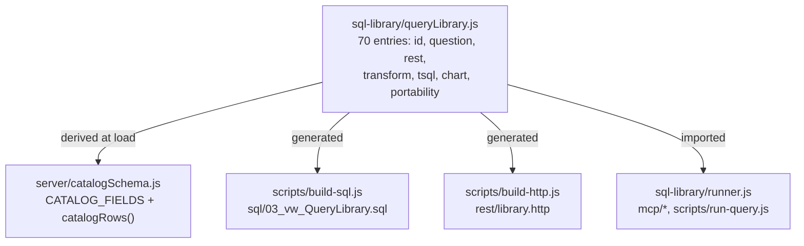
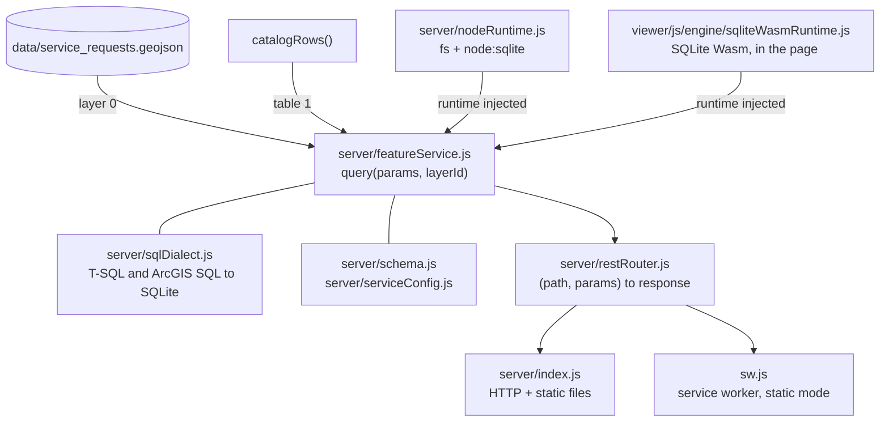
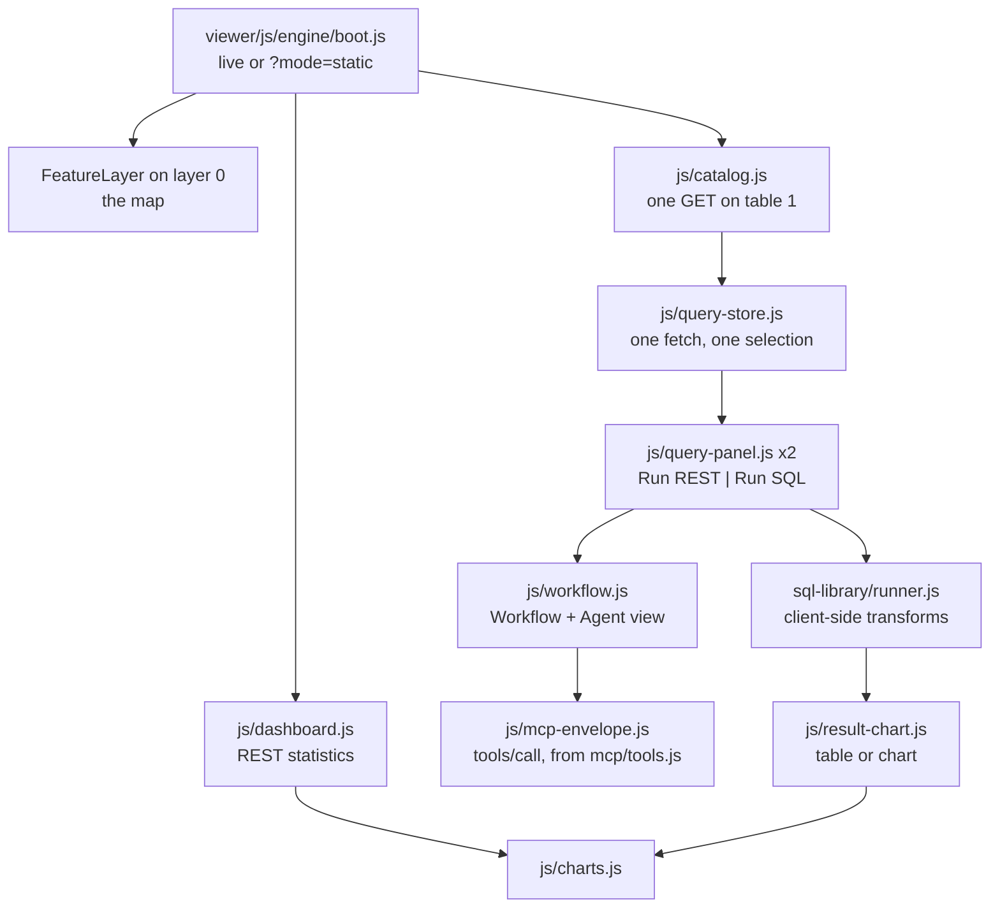
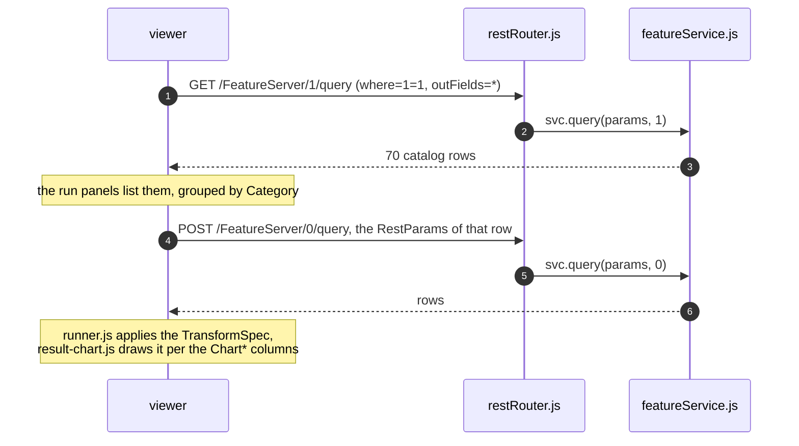

# Architecture

*How the parts fit together, and where the query library lives in each of the two databases.*

The repository is one pipeline with two front doors. A single query engine answers ArcGIS REST
requests; everything else is either a producer of its data, a renderer of its answers, or a
generator kept in step with it. The library of 70 analytical questions is not a module the UI
imports — it is **a table of the service**, discovered over REST like any other table.

## 1. The whole picture

Three bands. **Top:** one source file, three derivations — none of them a second copy to
maintain. **Middle:** the engine, with a runtime injected underneath it so the same code runs on
Node and in the browser. **Bottom:** the consumers, all of them speaking REST.

### Top: one source, three derivations



### Middle: one engine, two runtimes



The same `restRouter.js` answers in both modes, which is why the GitHub Pages demo needs no
server: `sw.js` intercepts the REST URLs and hands them to an engine running in the tab.

### Bottom: the viewer




## 2. Who references whom

| Component | Depends on | Must never import |
|---|---|---|
| `sql-library/queryLibrary.js` | nothing | — |
| `server/catalogSchema.js` | `queryLibrary.js` | anything platform-specific |
| `server/featureService.js` | `schema.js`, `catalogSchema.js`, `sqlDialect.js`, `serviceConfig.js`, an injected runtime | `node:*`, `process`, `Buffer` |
| `server/restRouter.js` | a `FeatureService` instance | HTTP objects |
| `server/index.js` | `restRouter.js`, `nodeRuntime.js` | — |
| `viewer/js/catalog.js` | the REST endpoint `…/FeatureServer/1/query` | `queryLibrary.js` |
| `viewer/js/query-store.js` | `js/catalog.js` | a second catalog fetch — there is one, shared |
| `viewer/js/query-panel.js` | `js/query-store.js`, `runner.js`, `js/workflow.js` | knowledge of which questions exist |
| `viewer/js/mcp-envelope.js` | `toolContent` from `mcp/tools.js` | a dispatcher — nothing in the page dispatches |
| `viewer/js/workflow.js` | `js/mcp-envelope.js`, the payload builders in `mcp/tools.js` | hand-built JSON-RPC |
| `mcp/server.js` | `mcp/tools.js`, `nodeRuntime.js` | — |
| `scripts/build-*.js`, `scripts/run-query.js` | `queryLibrary.js` directly | — |

Two of those rules are enforced by tests rather than by convention: `test/deploy.test.js`
resolves the browser's import closure and fails if a Node-only module enters it, and
`test/browser-engine.test.js` runs all 70 entries on both runtimes and fails if they diverge.

## 3. The library as a table (layer 1)

The service publishes two layers over one REST surface:

| Id | Name | Type | Rows | Source |
|---|---|---|---|---|
| 0 | `ServiceRequests` | Feature Layer | ~850 points | `data/service_requests.geojson` |
| 1 | `QueryLibrary` | Table (no geometry) | 70 questions | `catalogRows()` over `queryLibrary.js` |

`server/catalogSchema.js` declares the table's schema as `CATALOG_FIELDS`, in Esri field terms,
so `…/FeatureServer/1?f=json` describes it exactly as a real published table would:

| Field | Esri type | Length | What it holds |
|---|---|---|---|
| `ObjectID` | `esriFieldTypeOID` | — | the query number, reused as the OID |
| `QueryNumber` | `esriFieldTypeInteger` | — | 1–70, the stable public identifier |
| `Category` | `esriFieldTypeString` | 60 | one of the eight library sections |
| `Question` | `esriFieldTypeString` | 200 | the business question, and the display field |
| `Dimension` | `esriFieldTypeString` | 10 | `WHO` … `HOW` (see [framework](framework.md)) |
| `AnalyticLayer` | `esriFieldTypeString` | 4 | `L1`–`L5`, descriptive to advanced |
| `Portability` | `esriFieldTypeString` | 20 | `standard` · `sql-expression` · `native` · `extension` |
| `RequestCount` | `esriFieldTypeSmallInteger` | — | REST requests needed (1, or 2 for Q62) |
| `Transforms` | `esriFieldTypeString` | 100 | names of the client-side steps, comma-separated |
| `HasChart` | `esriFieldTypeSmallInteger` | — | 1 when the author says this answer is a chart (44 of 70) |
| `ChartType` | `esriFieldTypeString` | 20 | `bar` or `line` |
| `ChartLabelColumn` | `esriFieldTypeString` | 100 | the category axis; two columns joined when a label needs both (`Year,Month`) |
| `ChartValueColumns` | `esriFieldTypeString` | 200 | the measure(s) to plot — several only when they share a unit |
| `ChartSeriesColumn` | `esriFieldTypeString` | 100 | splits into one dataset per value, or null |
| `ChartAnnotationColumn` | `esriFieldTypeString` | 100 | carried into the tooltip without being plotted, or null |
| `RestParams` | `esriFieldTypeString` | 4000 | **the executable payload**: the decomposed query as JSON |
| `TransformSpec` | `esriFieldTypeString` | 1000 | the transform parameters as JSON, or null |
| `SqlText` | `esriFieldTypeString` | 4000 | the reference T-SQL statement |
| `Notes` | `esriFieldTypeString` | 600 | caveats (for example a `DATEFIRST` assumption), or null |

`RestParams` holds `where` / `groupByFieldsForStatistics` / `outStatistics` / `having` /
`orderByFields`, never a `SELECT` — see the [query catalog](query-catalog.md) for why that
distinction is the whole point of the pattern.

The `Chart*` columns are the presentation contract. No response type is declared for any
question anywhere in this pipeline, so these columns are the only place the shape of an answer
is written down: which column is the category axis, which are the measures, what splits into
series. `viewer/js/result-chart.js` obeys them and falls back to inferring from the shape of
the rows only for results that have no contract, such as anything run from the SQL console.
`HasChart = 0` is a statement in its own right — a single figure or a list of features is not
a chart — and the [catalog pattern](catalog-pattern.md) explains why a declared contract and an
inferred one are not the same kind of thing.

### How it is set up in the mock database

There is no DDL file for layer 1, because the table is built from the field list at start-up.
`featureService.load()` creates both layers the same way, in the same in-memory SQLite database:

```js
db.exec(`CREATE TABLE _QueryLibrary (${CATALOG_FIELDS.map((f) => `"${f.name}" ${sqlTypeOf(f)}`).join(', ')})`);
```

It then inserts `catalogRows()` and registers a **layer descriptor** — `{ id: 1, name:
'QueryLibrary', table: '_QueryLibrary', fields: CATALOG_FIELDS, oid: 'ObjectID', displayField:
'Question', timeField: null, geometry: false }` — alongside layer 0's. From that point the query
methods are layer-agnostic: `svc.query(params, 1)` takes the same `where`, `outFields`,
`outStatistics` and `orderByFields` path as a query against the points, which is why the catalog
can report on itself (`…/1/query?groupByFieldsForStatistics=Portability`). The database is
read-only (`PRAGMA query_only` plus a statement filter), both layers alike.

So **adding a question changes one array**. The table's rows, the `.http` file and the T-SQL
catalogue all follow from `npm run build`, and nothing in the viewer changes at all.

### How it is set up in SQL Server

The SQL Server side exists for comparison — proving the T-SQL and the REST request give the same
answer on identical data — so it carries the library in the simplest form that supports that:

| Script | Object | Form |
|---|---|---|
| `sql/01_ServiceRequest_table.sql` | `dbo.ServiceRequest`, `dbo.GeoJsonDocument` | tables plus three indexes; `Shape` is a computed `GEOGRAPHY::Point` |
| `sql/02_import_geojson.sql` | `dbo.vw_ServiceRequest_GeoJson`, `dbo.usp_ImportServiceRequestGeoJson` | view and stored proc over `OPENJSON`, epoch ms to SAST |
| `sql/03_vw_QueryLibrary.sql` | `dbo.vw_QueryLibrary`, `dbo.usp_RunLibraryQuery` | **generated** view of 70 `SELECT … UNION ALL` literals, plus the proc that runs one by number |

`vw_QueryLibrary` is a view of constants rather than a physical table, with five descriptive
columns and the statement itself:

| Column | Type | Note |
|---|---|---|
| `QueryNumber` | `INT` | matches `QueryNumber` on layer 1 |
| `Category` | `NVARCHAR` | same value |
| `Dimension` | `NVARCHAR` | same value |
| `AnalyticalLayer` | `NVARCHAR` | layer 1 calls this `AnalyticLayer` |
| `Question` | `NVARCHAR` | same value |
| `SQLText` | `NVARCHAR` | layer 1 calls this `SqlText` |
| `HasChart` | `INT` | same value |
| `ChartType`, `ChartLabelColumn`, `ChartValueColumns` | `NVARCHAR(200)` | same values |
| `ChartSeriesColumn`, `ChartAnnotationColumn` | `NVARCHAR(200)` | same values |

An entry is executed by number, through the proc form in the same script — the T-SQL counterpart
of replaying a row's `RestParams` against layer 0:

```sql
EXEC dbo.usp_RunLibraryQuery @QueryNumber = 44;                 -- run it
EXEC dbo.usp_RunLibraryQuery @QueryNumber = 44, @Execute = 0;    -- return the statement only
```

It resolves `SQLText` from the view and hands it to `sys.sp_executesql`, throwing 50010 for a
number that is not in the catalogue. The underlying two lines work as well, if a caller would
rather hold the statement itself:

```sql
DECLARE @sql NVARCHAR(MAX) = (SELECT SQLText FROM dbo.vw_QueryLibrary WHERE QueryNumber = 44);
EXEC sp_executesql @sql;
```

Note what this deliberately is **not**. It is not a physical table, so there is no load step and
no stored row that can drift from the library — regenerate the file, re-run it, and the view is
current. And it is not the same schema as layer 1: it has no `Portability`, `RequestCount`,
`Transforms`, `RestParams` or `TransformSpec`, because those describe the *REST* half of an entry
and mean nothing to a client that already holds a T-SQL statement. The two catalogues are two
projections of one source, each carrying the columns its own execution path can act on.

The `Chart*` columns are the exception that shows the rule: they appear in both, because they
describe the *answer* rather than the route taken to it. Whichever way a client resolves query 44
— replaying `RestParams` against layer 0, or `EXEC dbo.usp_RunLibraryQuery @QueryNumber = 44` —
it gets the same rows and the same instruction for drawing them.

## 4. The two REST hops, end to end



Both hops are the standard ArcGIS `query` operation, and nothing about Q44 exists in the client.

See also: [query catalog](query-catalog.md) for the design argument and its three real limits,
[data model](data-model.md) for layer 0's fields, [analytics framework](framework.md) for the
dimensions the catalog columns expose.
